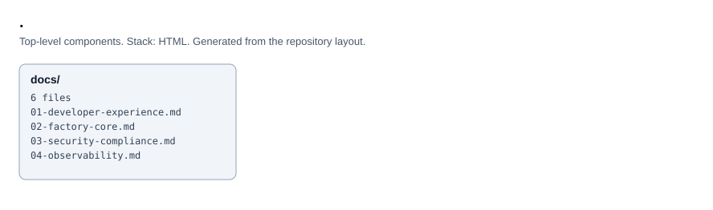

# Software Factory Architecture

Reference architecture for a multi-cloud DevSecOps platform across AWS, Azure and GCP.

- `index.html`: the overview page
- `docs/`: numbered chapters on developer experience, the factory core, security and compliance, observability, cloud execution and design principles

<!-- project-structure -->
## Project structure

```text
├── docs/
│   ├── 01-developer-experience.md
│   ├── 02-factory-core.md
│   ├── 03-security-compliance.md
│   ├── 04-observability.md
│   ├── 05-cloud-execution.md
│   └── 06-design-principles.md
├── LICENSE
├── README.md
└── index.html
```

<!-- architecture -->
## Architecture


